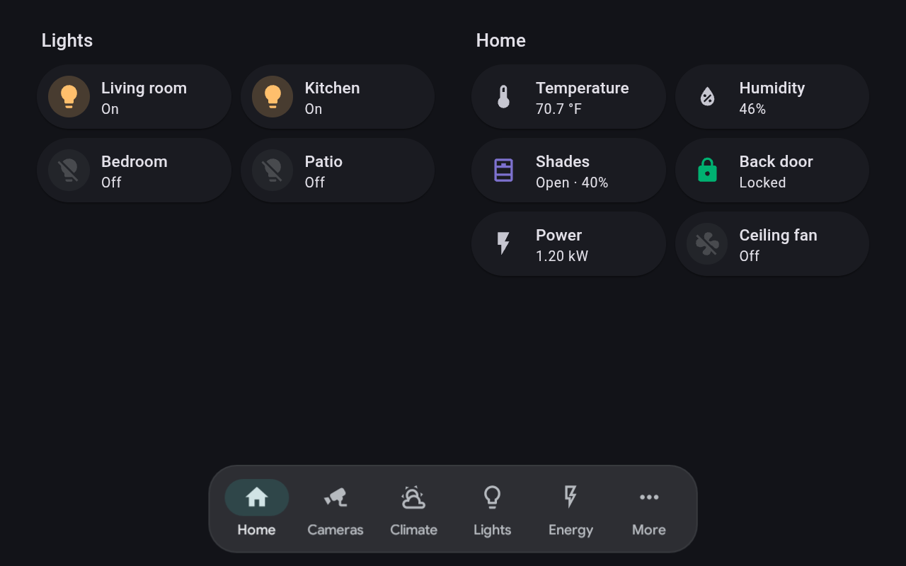
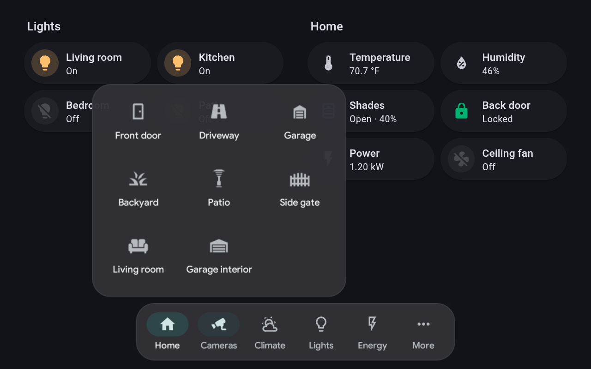
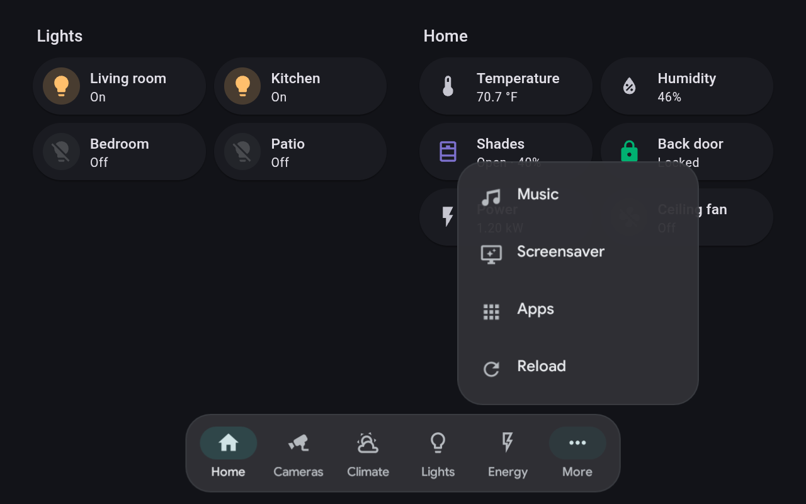
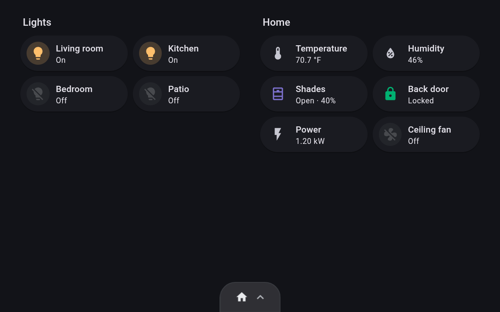
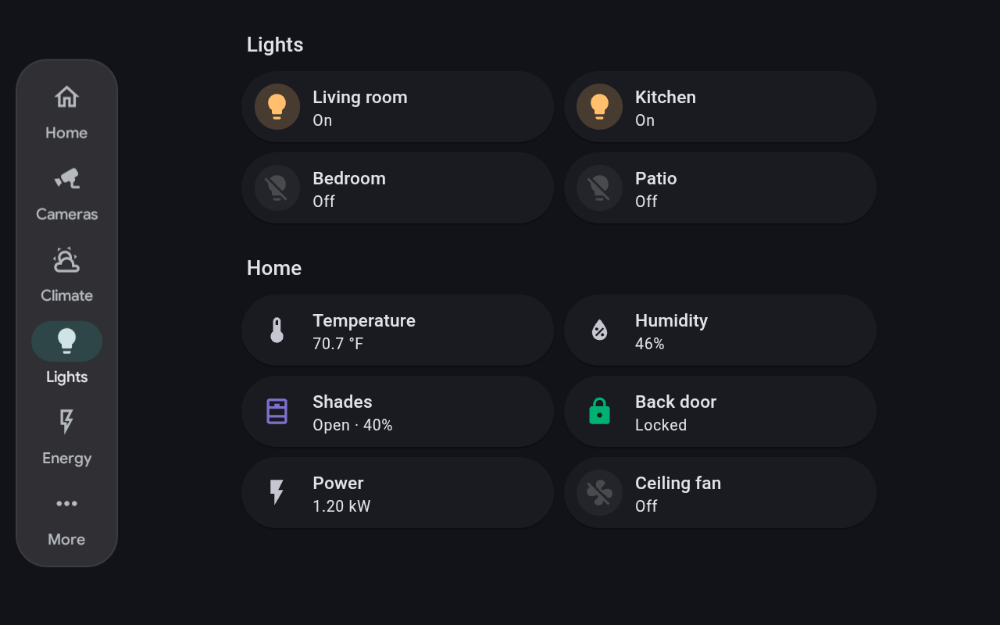

# Navbar for Kiosk Satellite

**A native navigation bar for [Kiosk Satellite](https://github.com/jxlarrea/kiosk-satellite) wall panels.** It highlights the page you're on, opens menus and camera grids, and keeps your Home Assistant dashboard clear of it. Kiosk Satellite draws it with its own colors, type and icons, so it looks like part of the kiosk.

<p align="center"></p>

| Grid menu | List menu | Hidden |
| :---: | :---: | :---: |
|  |  |  |
| Long menus, such as cameras, show as tiles | Short menus show as a list | Swipe down to hide the bar behind a tab |

A companion to [Action Bar for Kiosk Satellite](https://github.com/dimatx/kiosk-satellite-action-bar): the navbar moves between pages, the action bar switches lights, shades and locks in place. Put the navbar along the bottom and the action bar on the right, and the dashboard keeps clear of both.

## Why use it

- **Knows where you are.** The item for the page on screen lights up, however you got there.
- **Menus and grids.** An item can open a list, or a grid of tiles for things like cameras. Optionally, a tap opens a page and a long press opens the menu.
- **More than pages.** Items can open camera views, the calendar, Music Assistant, Now Playing, the screensaver, the app launcher or a web address.
- **Keeps the dashboard clear.** The dashboard ends above the bar, so no card hides under it. No card-mod needed.
- **Works over camera views.** The bar stays on screen while a camera view is open, with a **Close** button, so you can switch cameras or leave without reaching for the camera view's own controls.
- **Any edge.** A bar along the bottom or top, or a rail down the left or right side.
- **Out of the way.** Set how translucent it is, and swipe it away behind a small tab.
- **Made for fleets.** Set it up once on the fleet leader and every kiosk gets the same bar. Each kiosk's **Scale UI** sets its size.
- **Set up without typing.** Pages, camera views and icons each have a picker.
- **Light.** Native Android views, no WebView and no Home Assistant token.

## Installation

Needs Kiosk Satellite **2026.10.42** or newer. On **2026.10.30** and newer the bar follows each kiosk's **Scale UI**. Kiosk Satellite shows the requirement before it installs or updates, and an older release keeps running the version it has.

### Community Plugins (Recommended)

Navbar is listed in [Community Plugins](https://kiosksatellite.com/plugins/). Use the button below to open it in your Kiosk Satellite and install it.

[](https://kiosksatellite.com/redirect/plugin/?repository=dimatx/kiosk-satellite-navbar)

Or search for `Navbar` in **Settings > Plugin Manager > Browse plugins** in Kiosk Satellite.

### Manual

1. Open **Settings > Plugin Manager** in Kiosk Satellite and turn on **Enable Plugins**.
2. Choose **Add plugin**, paste `https://github.com/dimatx/kiosk-satellite-navbar` and choose **Preview**.
3. Review the plugin and choose **Trust and install**.

### First steps

Turn on **Navbar**. It starts with a Home item. Open **Navbar** and add your own items under **Items**. With Fleet Management, add Navbar to a profile's **Plugins** row and every kiosk on it gets the same bar.

Settings are on the plugin's page, on the kiosk or in Remote Admin, and take effect as you save them.

## Items

Each item has a **Label**, what it **Opens**, and optional icons.

| Opens | You pick | A tap |
| --- | --- | --- |
| Page | A dashboard view | Opens the view. The item lights up while it's shown |
| Built-in page | Energy, Map, Logbook, History, To-do, Media, or Other with a path | Opens a page Home Assistant provides itself. The item stays lit on its tabs, such as Energy's Electricity and Gas |
| Any action | Anything you can pick in Gestures, such as another plugin's command | Runs the action you choose, with no code in this plugin. Use it to open another plugin's view, for example a doorbell camera |
| Camera view | One of the kiosk's camera views | Opens the camera view |
| Calendar | Default, Day, Week, Month or Schedule | Opens the kiosk's calendar on that view. Default uses the view picked under **Settings > Calendar** |
| Menu | Up to 16 entries | Opens the menu beside the item, or centered on the bar when it is wider than the bar. More than 6 entries show as a grid |
| Kiosk action | Music, Now playing, Screensaver, App launcher, Reload or Start page | Runs it |
| App | One of the apps under **Settings > App Launcher > Apps** | Opens the app over the kiosk. Press **Refresh** beside the picker after adding apps. The list is empty while the App Launcher is off or Lockdown Mode is on |
| Web address | An `https://` address | Loads it in the kiosk |

| Editing a page item | Editing a menu |
| :---: | :---: |
|  |  |

- **Icons.** Leave an icon empty and one is picked from the label, and the bar draws it: *Garage* gets a garage, *Driveway* a road, *Living room* a sofa. **Selected icon** is shown while the item's page is open, often the filled version.
- **Tap opens.** On a menu item, pick a page here and a tap opens that page while a long press opens the menu. Leave it empty and a tap opens the menu.
- **Order.** Drag rows by their handle to reorder items or menu entries. A bar holds up to 16 items.
- **Smaller screens.** If the bar does not fit, scroll along it to reach the remaining items. Menu grids use fewer columns when space is limited, and tall menus scroll.

## Settings

<p align="center"></p>

| Setting | What it does |
| --- | --- |
| Position | Bottom, Top, Left or Right. Left and Right make a vertical rail |
| Labels | Always, Active only or Never |
| Size | 80% to 140%, on top of the kiosk's **Scale UI** |
| Opacity | How much of the dashboard shows through |
| Swipe to hide | Start visible, Start hidden or Off |
| Hide after | Seconds without a tap before the bar hides. 0 keeps it visible |
| Keep the dashboard clear | The dashboard ends above the bar instead of under it. On by default |
| Show over camera views | Keep the bar on screen while a camera view is open, with a Close button. On by default |
| Hide the bar on | Pages where the bar stays hidden, picked from your dashboards |

<details>
<summary><b>Left and right rails</b></summary>

<p align="center"></p>

On the left or right, the bar becomes a rail. Menus open beside it, a sideways swipe hides it behind a tab on the edge, and the dashboard keeps clear of it in the same way.

</details>

<details>
<summary><b>Hiding the bar</b></summary>

Swipe the bar toward its edge to hide it behind a small tab. Swipe the tab back, or tap it, to show the bar again. The tab shows the current page's icon. While the bar is hidden, the dashboard keeps clear of the tab only.

**Hide after** pauses while a menu is open. The menu closes automatically after 30 seconds, even if untouched; closing it starts a fresh auto-hide countdown for the bar. Choosing an entry or dismissing the menu does the same. Changing **Hide after** takes effect immediately.

</details>

<details>
<summary><b>Gestures and the kiosk drawer</b></summary>

**Show navbar**, **Hide navbar** and **Toggle navbar** can be mapped to a gesture or added to the kiosk drawer, under the plugin's **Actions**.

</details>

<details>
<summary><b>Build from source</b></summary>

Needs a JDK, Python 3 and the Android SDK with `ANDROID_HOME` set.

```sh
python3 tools/test.py
python3 tools/build.py
```

The ZIP lands in `dist/`. Install it with **Plugin Manager > Developer Tools > Install from ZIP**. To release, publish a GitHub release tagged `vX.Y.Z`. CI tests, builds and attaches the files Kiosk Satellite verifies. See [CHANGELOG.md](CHANGELOG.md) for what changed in each version. [docs/releasing.md](docs/releasing.md) covers versions, releases and keeping settings across updates.

`tools/test.py` also runs the controller against a virtual clock and deferred host responses. For native Android layout checks, run `python3 tools/test_views.py --serial <adb-device-serial>` on an adb-connected development device. It measures views without opening a window or installing an app, and removes its temporary test bundle afterward. This checks layout and drawable reuse, not KS's compositor latency.

</details>

## Privacy

Navbar sends nothing anywhere. It asks Kiosk Satellite to open dashboard pages, camera views, web addresses and kiosk actions you configure, and reads which page is showing so it can highlight the right item. It has no network access of its own and never sees a Home Assistant token.

## Credits

Built for [Kiosk Satellite](https://github.com/jxlarrea/kiosk-satellite) by [@jxlarrea](https://github.com/jxlarrea), whose native plugin SDK, overlays, pickers and icons make a bar like this possible. Started from the [Kiosk Satellite plugin template](https://github.com/jxlarrea/kiosk-satellite-plugins).

Loosely inspired by [lovelace-navbar-card](https://github.com/joseluis9595/lovelace-navbar-card) by [@joseluis9595](https://github.com/joseluis9595). Plugin SDK limits found along the way are tracked in [docs/sdk-gaps.md](docs/sdk-gaps.md).

## License

[Apache-2.0](LICENSE). See [NOTICE](NOTICE) for what comes from the Kiosk Satellite plugin template.
